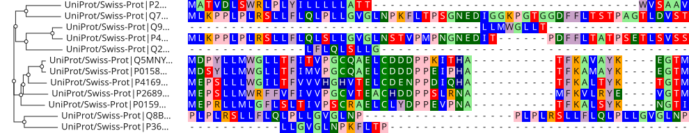

# react-msaview

A React component for viewing multiple sequence alignments: a phylogenetic tree
rendered alongside a protein or DNA alignment, with protein domain annotations,
many color schemes, and SVG export.



## Install

```sh
npm install react-msaview @jbrowse/core@next mobx@7 mobx-react@10 \
  @jbrowse/mobx-state-tree@6 @mui/material@9 @mui/icons-material@9 \
  @emotion/react @emotion/styled react react-dom
```

The line pins the mobx, mobx-state-tree and MUI majors the viewer shares with
`@jbrowse/core`, so the app gets one copy of each. The
[usage guide](https://github.com/GMOD/JBrowseMSA/blob/main/USAGE.md#troubleshooting)
lists the errors a second copy throws.

## Quick start

```tsx
import { MSAViewer } from 'react-msaview'

export default function App() {
  // backticks (template literal) so the \n become real newlines
  return (
    <MSAViewer
      msa={`>human\nMKAANSE\n>mouse\nMKA-NSE`}
      tree="(human:0.1,mouse:0.2);"
      colorScheme="clustal"
    />
  )
}
```

`MSAViewer` creates the model, measures width, and applies the theme for you.
For full control, use the `MSAModelF` / `MSAView` model-based API described in
the
[usage & embedding guide](https://github.com/GMOD/JBrowseMSA/blob/main/USAGE.md).

## Docs & links

- [Usage & embedding guide](https://github.com/GMOD/JBrowseMSA/blob/main/USAGE.md):
  props, model API, UMD bundle, R
- [Live examples](https://gmod.org/JBrowseMSA/examples): runnable snippets
- [Model API reference](https://github.com/GMOD/JBrowseMSA/blob/main/packages/lib/apidocs/MsaView.md)
- [Main repository](https://github.com/GMOD/JBrowseMSA)
- [CLI](https://github.com/GMOD/JBrowseMSA/tree/main/packages/cli): domain and
  exon GFFs, plus headless SVG export
- [msa-parsers](https://github.com/GMOD/JBrowseMSA/tree/main/packages/msa-parsers):
  standalone parsing library
- [ProteinBrowser](https://github.com/GMOD/proteinbrowser): protein analysis
  suite built on this viewer
